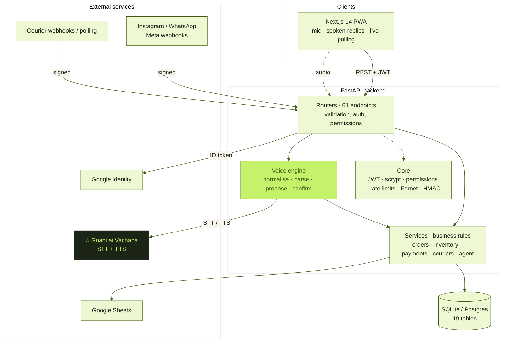
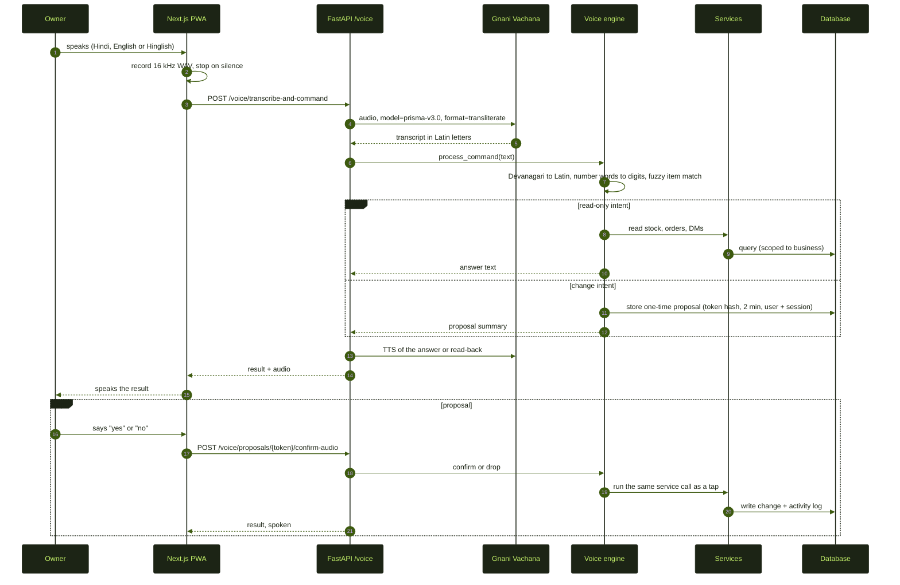
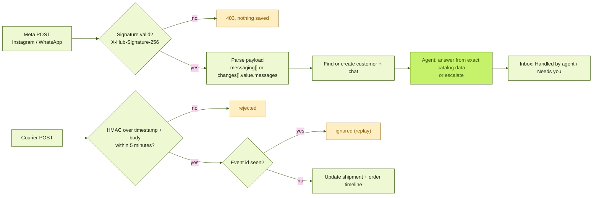
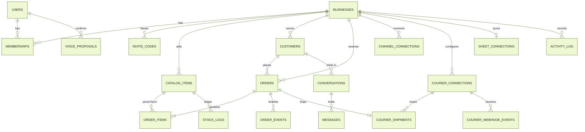

<p align="center">
  
</p>

<p align="center">
  
  
  
</p>
<p align="center">
  
  
  
  
  
</p>

<p align="center">
  <a href="#-the-problem">Problem</a> ·
  <a href="#-gnani-ai-voice-the-heart-of-factor">Gnani voice</a> ·
  <a href="#-everything-else-in-factor">Features</a> ·
  <a href="#-technical-architecture">Architecture</a> ·
  <a href="#-repository-structure">Structure</a> ·
  <a href="#-security-model">Security</a> ·
  <a href="#-run-it">Run it</a> ·
  <a href="#-demo-without-meta-or-a-courier-account">Demo</a> ·
  <a href="#-honest-limits">Limits</a>
</p>

<p align="center"></p>

## 📌 At a glance

| | |
|---|---|
| **What** | A free, voice-first operations app for solo Instagram and WhatsApp sellers in India. { Impacts nearly 70% of the global economy from the same DM frustrations all the time }  |
| **Who it is for** | One-person businesses that take orders by DM and run on notebooks and memory. |
| **The big idea** | Run the whole business by talking to it, in Hindi, English or Hinglish, with spoken confirmation and spoken errors. |
| **Built for** | The Gnani.ai Great Indian AI Internship Challenge. |
| **Voice stack** | Gnani.ai Vachana speech-to-text (`prisma-v3.0`) and text-to-speech (Timbre v2.5), called only from the server. |
| **Backend** | FastAPI · SQLAlchemy 2 · Pydantic v2 · PyJWT · SQLite or Postgres · Alembic |
| **Frontend** | Next.js 14 · Tailwind CSS · installable PWA · live polling |
| **Scale of the build** | 61 API endpoints · 19 tables · 141 automated tests · 2 demo scripts |
| **Design principle** | **The AI listens, code decides.** Gnani turns speech into text. Tested code makes every decision. The owner approves every change. |

<p align="center"></p>

## The problem

Millions of Indian small businesses sell through **Instagram and WhatsApp DMs**. One person answers every message, writes orders in a notebook, chases payments, packs parcels, and replies to *"where is my order?"* all day. Usually with one hand free, and often in **Hindi or Hinglish**.

Existing tools are built for typing, in English, at a desk. The seller is standing at a packing table.

> **Factor turns DMs into orders, and lets the owner run everything with their voice.**
> Tap the mic. Speak. Factor does it, reads it back, and waits for a spoken **yes**.

<p align="center"></p>

<!--
=====================================================================
TESTIMONIAL: add ONE real quote here, with the seller's permission.
Do not invent or paraphrase one. When you have it, delete the comment
markers around the block below and fill in the three [brackets].
=====================================================================

## 💬 What a seller says

> "[The seller's own words, exactly as they said or wrote them.]"
>
> **[Name]** · [what they sell] · [city] · sells through Instagram
-->

<p align="center"></p>

## Gnani.ai voice: the heart of Factor

Voice is not a feature added on top. It is the main way to use the app, built on **Gnani.ai's Vachana APIs**.

<p align="center"></p>

| Gnani capability | How Factor uses it |
|---|---|
| **Speech-to-text** · Vachana STT v3 (`prisma-v3.0`) | The seller speaks in Hindi, English or Hinglish. Audio goes from the browser to our API, which calls Gnani and returns the transcript. |
| **Output formats** · `transliterate`, `codemix` | By default, English words came back in Devanagari ("हाउ मेनी रोजेस आर लेफ्ट") and commands failed. Asking Gnani for transliterated output returns clean Latin text the command engine can read. Set with `GNANI_STT_FORMAT`. |
| **Indic auto language detection** | No language picker. The seller can switch between Hindi and English mid-sentence. |
| **Text-to-speech** · Timbre v2.5 | Answers, read-backs, confirmations and **every error message** are spoken aloud. |

### What you can say

| Say this | What happens |
|---|---|
| "Open orders" · "go to inventory" · "take me to the inbox" · "kholo settings" | Navigates there. Works for every main screen, plus "open order ORD-1001" and "open chat 3". |
| "Give me a summary" | Spoken briefing: today's orders and revenue, new orders to confirm, chats waiting, low stock. |
| "How many roses are left?" · "roses kitne bache hain" | Spoken stock count, with a warning when it is low. |
| "Read low stock" · "read today's messages" · "show recent orders" | Reads the list aloud and shows it on screen. |
| "Restock 4 to roses" · "count 12 for roses" | Reads the change back, waits for **yes**, then updates stock and the ledger. |
| "Rahul ordered 2 roses" | Proposes a new order with prices taken from the catalog. |
| "Confirm order ORD-1001" · "mark ORD-1001 shipped" | Proposes the status change. Cancelling needs the extra words "yes cancel". |
| "Take payment from Riya" · "Riya se payment lo" | Finds Riya's unpaid order and sends the UPI payment QR. |
| "Reply to chat 3 saying thank you" | Reads the reply back, saves it to the chat after **yes**. |

### Built for how people really speak

- 🇮🇳 **Hindi script, Hinglish and English** all work. Devanagari transcripts are transliterated to Latin before parsing.
-  **Number words** become digits: "four", "char", "twenty five", "bees".
-  **Fuzzy item matching** tolerates plurals and spelling slips: "rose" finds *Roses*, "रोजेस" finds *Roses*.
-  **Tolerant of recognition mistakes**, like "saying" heard as "Singh" in a reply command.
-  **Hands-free loop**: tap once and keep talking. The mic reopens after each answer and closes when you go quiet.
-  **Errors are spoken everywhere**, even on the login screen. If Gnani speech is unavailable, the browser's own voice takes over.

### 🛡️ Voice safety

<p align="center"></p>

1. Gnani transcribes the audio.
2. A **rule-based parser** (not a language model) maps it to a known action.
3. Factor reads the change back: *"Add 4 to Roses, current stock 15."*
4. Nothing is saved until the owner says **yes** or **haan**. **No** drops it.
5. Proposals are single-use, expire in 2 minutes, and are tied to the signed-in user *and* their exact login session.

Only the server holds the Gnani API key. The browser never sees it.

<p align="center"></p>

##  Everything else in Factor

<p align="center"></p>

<details>
<summary><b>📥 Inbox that works for you</b></summary>

- Instagram and WhatsApp messages arrive through **Meta webhooks**, with signature verification.
- A **rule-based agent** answers standard questions (price, availability, tracking) from exact catalog data, and **hands over** complaints, bargaining, custom requests and payment claims to the owner.
- Two lists, **Handled by agent** and **Needs you**, refresh live every few seconds.
- The agent never invents a price or a stock number. Code decides those, always.
</details>

<details>
<summary><b> Orders, catalog and inventory</b></summary>

- Ready-stock items with live quantity, and made-to-order items with capacity.
- Orders move through a checked pipeline (new, confirmed, packed, shipped, delivered) with an evidence timeline.
- Stock and capacity are checked at order time, so you cannot oversell.
- Every stock change (order, restock, count) is written to a ledger with who did it and why. Low-stock warnings show on the dashboard and by voice.
</details>

<details>
<summary><b> UPI payments</b></summary>

- Each order gets a signed payment page with a **UPI QR code**.
- Say "take payment from Riya" and the QR goes to her chat.
- Delivery over Instagram or WhatsApp works once Meta sending is connected. Until then the payment link is placed in the customer's chat, ready to send.
</details>

<details>
<summary><b> Courier tracking</b></summary>

- Attach a tracking number, update status by hand, or connect a courier.
- **Signed courier webhooks** update tracking live. Events are HMAC-signed with a 5-minute window, and replays are ignored.
</details>

<details>
<summary><b> Google Sheets sync</b></summary>

One-way snapshots of Orders, Inventory and Stock log to a Google Sheet, for owners who live in spreadsheets.
</details>

<details>
<summary><b>👥 Team, access and more</b></summary>

- One owner by default. Teammates join with a **business code** and get no access until the owner approves them.
- Per-person permissions, enforced on the server. Email sign-up and **Google sign-in**.
- Live overview dashboard, customer list with order history, and an activity log that includes every voice action.
- Installable as a phone app (PWA) with the Factor icon.
</details>

<p align="center"></p>

##  Technical architecture

Factor is a **modular monolith**: one FastAPI service with strict layers, one database, and a Next.js client. Voice, Instagram and WhatsApp messages, and courier updates are three different doors into the *same* rules.

### System view



**Layering rules** (enforced by convention and by tests):

| Layer | Responsibility | May call |
|---|---|---|
| `routers/` | HTTP shape, auth, permission checks, input validation (Pydantic) | services, schemas |
| `services/` | All business rules: stock, pricing, state transitions, payments, escalation | models, other services, integrations |
| `ai/` | Voice text normalisation, intent parsing, Gnani client, agent guardrails | services (read and propose), never the database directly for writes |
| `integrations/` | Adapters for Meta, couriers, Google Sheets, UPI, storage | external APIs only |
| `core/` | Security primitives: hashing, tokens, permissions, rate limits, encryption, state machines | nothing above it |
| `models/` | SQLAlchemy 2 tables | nothing |

### A voice command, end to end



### Inbound webhooks



### Data model

19 tables in five areas. Every business-owned row carries `business_id`, and every query is filtered by it.



| Area | Tables |
|---|---|
| Identity and access | `users`, `businesses`, `memberships`, `invite_codes` |
| Commerce | `catalog_items`, `customers`, `orders`, `order_items`, `order_events` |
| Conversations | `conversations`, `messages`, `channel_connections` |
| Operations | `stock_logs`, `courier_connections`, `courier_shipments`, `courier_webhook_events`, `sheet_connections` |
| Trust | `activity_log`, `voice_proposals` |

Schema changes are managed with **Alembic** (`apps/api/migrations`).

### Key design decisions

| Decision | Why |
|---|---|
| **Rule-based command parser, not an LLM** | A misheard sentence must never cost money. Rules are testable, fast and free, and give predictable behaviour. Gnani handles the hard part, speech. |
| **`transliterate` output from Gnani** | Hindi-script transcripts of English words broke command parsing. Latin output plus our own normaliser is more robust than guessing scripts. |
| **Proposal and confirm, never direct write** | Each voice change is a single-use proposal read back to the owner, so a recognition error costs one "no". |
| **Same service call for tap and voice** | Voice has no special write path, so every rule (stock, permissions, logging) applies equally. |
| **Append-only stock ledger** | The count is always explainable, and Sheets sync reads the ledger. |
| **Per-business scoping on every query** | Multi-tenant safety without row-level security tricks. |
| **Signed, replay-safe webhooks** | Meta and couriers are the internet-facing surface, so they are the first thing we harden. |
| **Debounced Sheets sync** | Orders and stock changes trigger one sync a few seconds later, instead of one call per change. |
| **Polling, not websockets** | Works on weak mobile networks, behind any host, with no extra infrastructure. |

<p align="center"></p>

## 🗂️ Repository structure

```text
factor/
├── apps/
│   ├── api/                         FastAPI backend
│   │   ├── app/
│   │   │   ├── main.py              app factory, CORS, router registration
│   │   │   ├── config.py            settings (reads .env, env vars win)
│   │   │   ├── db.py, deps.py       session, auth and permission dependencies
│   │   │   ├── routers/             HTTP layer, 61 endpoints
│   │   │   │   ├── auth.py  business.py  team.py  catalog.py  orders.py
│   │   │   │   ├── inbox.py  channels.py  webhooks.py  customers.py
│   │   │   │   ├── inventory.py  payments.py  couriers.py  sheets.py
│   │   │   │   └── dashboard.py  voice.py
│   │   │   ├── services/            business rules (orders, inventory, payments, ...)
│   │   │   ├── ai/                  speech.py (Gnani), voice_text.py, extractor.py, agent, guardrails
│   │   │   ├── integrations/        courier, google_sheets, instagram, whatsapp, upi, email
│   │   │   ├── models/              SQLAlchemy tables
│   │   │   ├── schemas/             Pydantic request and response models
│   │   │   └── core/                security, permissions, rate_limit, encryption, state_machines
│   │   ├── migrations/              Alembic
│   │   ├── tests/                   141 tests
│   │   └── requirements*.txt
│   └── web/                         Next.js 14 PWA
│       └── src/
│           ├── app/                 routes: (auth) login, signup, join · (app) dashboard, inbox,
│           │                        orders, catalog, inventory, customers, payments, settings, team
│           │                        · public /pay/[orderId]
│           ├── components/          ui kit, layout, inbox, orders, voice, dashboard, ...
│           ├── hooks/               usePolling, useAuth, useBusiness
│           └── lib/                 api.ts (+ error announcer), voice.ts (recorder),
│                                    speak.ts (TTS), auth.tsx, permissions.ts
├── docs/                            architecture, data model, decisions, demo script, assets/
├── scripts/                         seed data, inbox simulator
├── demo_meta.py                     Instagram + WhatsApp webhook demo
├── demo_webhooks.py                 courier webhook demo
├── docker-compose.yml               local Postgres (make db-up)
└── Makefile                         api-install, api-test, api-dev, web-install, web-dev
```

<p align="center"></p>

##  API surface

61 endpoints in 15 routers, all documented interactively at `/docs` (OpenAPI).

| Router | Endpoints | What it covers |
|---|---:|---|
| `auth` | 5 | Email sign-up and login, Google sign-in, current user, auth config |
| `business` | 4 | Business profile and settings, including the UPI ID |
| `team` | 6 | Business code, join requests, approval, role presets, permission toggles |
| `catalog` | 3 | Ready-stock and made-to-order items |
| `orders` | 4 | Create, list, view, status transitions with event timeline |
| `inbox` | 6 | Conversations, messages, owner replies, and a message simulator |
| `channels` | 5 | Connect Instagram or WhatsApp, verify tokens, webhook paths |
| `webhooks` | 1 | Inbound Meta events |
| `customers` | 1 | Customer list with history |
| `dashboard` | 1 | KPIs and action center |
| `inventory` | 4 | Stock overview, history, restock, count |
| `payments` | 4 | Pending list, signed public payment page, UPI QR (SVG and PNG) |
| `couriers` | 5 | Connections, shipment, manual status, poll, signed webhook |
| `sheets` | 5 | Connect, update, sync now, disconnect |
| `voice` | 7 | Status, commands, transcribe-and-command, speak, proposal confirm (tap and audio) |

<p align="center"></p>

##  Security model

| Threat | Defence |
|---|---|
| Misheard voice command changes data | One-time proposals, read back, spoken yes required. Cancelling an order needs "yes cancel". |
| Proposal replay or theft | Single-use, 2-minute expiry, bound to the user and login session, token stored as a hash. |
| Gnani key exposure | Server-side only. The browser calls our API, never Gnani. `.env` is git-ignored and `.env.example` is blank. |
| Forged Meta message | `X-Hub-Signature-256` HMAC check with the app secret. |
| Forged or replayed courier event | HMAC over timestamp and body, 5-minute window, event-id de-duplication. Courier credentials encrypted at rest (Fernet). |
| Cross-tenant data access | `business_id` on every row, every query scoped, covered by `test_business_scope`. |
| Over-privileged teammate | Role presets plus owner-granted permission toggles, enforced per route on the server. |
| Credential attacks | scrypt password hashing, JWT sessions, rate limits on login and business-code attempts. |
| Hostile input | Pydantic validation on every request body, parameterised queries through SQLAlchemy. |

<p align="center"></p>

##  Testing

**141 automated tests** run with `python -m pytest -q` in about 25 seconds, on an in-memory database.

| Area | What is covered |
|---|---|
| Voice | Hindi, Hinglish and English commands, Devanagari transcripts, number words, fuzzy matching, navigation, stock questions, payments, reply commands, spoken yes and no, proposal expiry and session binding |
| Orders and stock | Order flow, stock and capacity checks, ledger, restock and count, low stock |
| Payments | UPI QR generation, signed public links, payment matching |
| Webhooks | Meta handshake and signatures, courier HMAC, replay protection |
| Inbox agent | Guardrails, escalation rules, dispute triage |
| Access | Business scoping, join-by-code, roles and permissions, Google sign-in, rate limits |
| Sheets | Snapshot sync |
| Web | Voice recorder state machine (`node --test`), type check, production build |

<p align="center"></p>

## 🚀 Run it

**Backend** (Windows PowerShell shown; on Mac or Linux use `source .venv/bin/activate`):

```powershell
cd apps\api
python -m venv .venv
.\.venv\Scripts\activate
pip install -r requirements.txt
copy .env.example .env      # then fill in your keys, see below
python -m pytest -q
uvicorn app.main:app --reload
```

**Frontend:**

```powershell
cd apps\web
npm install
npm run dev
```

Open <http://localhost:3000>. API docs are at <http://localhost:8000/docs>.

<details>
<summary><b>🔐 Environment variables (<code>apps/api/.env</code>)</b></summary>

| Variable | Purpose |
|---|---|
| `GNANI_API_KEY` | Your Gnani Vachana key. **Server only.** Never commit it or put it in the web app. |
| `GNANI_STT_FORMAT` | `transliterate` (default) or `codemix`. |
| `JWT_SECRET` | Long random string for sign-in tokens. |
| `GOOGLE_CLIENT_ID` | Turns on Google sign-in. |
| `COURIER_ENCRYPTION_KEY` | A Fernet key: `python -c "from cryptography.fernet import Fernet; print(Fernet.generate_key().decode())"` |
| `META_APP_SECRET` | Verifies Instagram and WhatsApp webhook signatures. |
| `GOOGLE_SERVICE_ACCOUNT_JSON` | Optional. For Google Sheets sync. |
| `DATABASE_URL` | Optional. Defaults to local SQLite. Use Postgres when deployed. |

</details>

> 🎤 Voice recording needs `localhost` or HTTPS, and microphone permission in the browser.

###  Try voice in 60 seconds

1. Sign up, create a business, add an item called **Roses** with quantity 15.
2. Tap **Voice** in the corner and say **"How many roses are left?"**
3. Say **"Restock four to roses."** Factor reads it back. Say **"yes"**.
4. Say **"Open orders."** The app navigates. Then say **"Give me a summary."**

<p align="center"></p>

## 🎬 Demo without Meta or a courier account

Two scripts play the outside world against your running app, using each service's real message formats:

```powershell
python demo_meta.py     --email you@example.com --password yourpass   # Instagram + WhatsApp DMs, handshake, forged-signature rejection
python demo_webhooks.py --email you@example.com --password yourpass   # signed courier events: picked up, in transit, out for delivery, delivered
```

Open the Inbox and an order page beside the terminal and watch them update live. Add `--api https://your-api-url` to run them against a deployed app.

## Honest limits

We would rather you hear these from us:

- **Replies are saved in the app but not yet delivered back through Instagram or WhatsApp.** That needs Meta app review and a public HTTPS address. Incoming messages and webhooks are fully built, and the demo scripts show them working.
- Real carrier tracking APIs need each seller's own credentials. Manual and signed-webhook tracking work today.
- **The customer tracking page, public shop page, complaint form with evidence upload, and reports and exports are placeholders.** The owner workflow came first.
- The voice grammar covers orders, stock, payments, navigation and replies. It does not yet cover team permissions, creating catalog items, or voice login.
- Voice understanding is rule-based by design, for safety. Unusual phrasings get a short spoken hint, never a guess.

## 🗺️ Roadmap

Send replies and payment QRs through Meta once approved · one-click "Connect Google Sheets" · voice for catalog and team management · more Indian languages in the command grammar · spoken replies in the seller's own language · a weekly business summary read aloud.

<p align="center"></p>

<p align="center">
  <b>factor.</b> because the person running the business should not have to stop packing to type.<br>
  Built for the <b>Gnani.ai Great Indian AI Internship Challenge</b> by <b>Aaliya Khan</b> (SGSITS Indore) and team.
</p>
