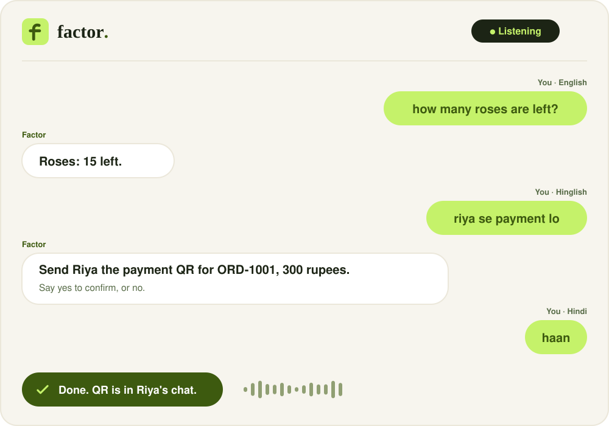
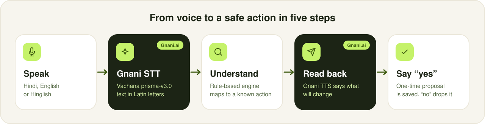
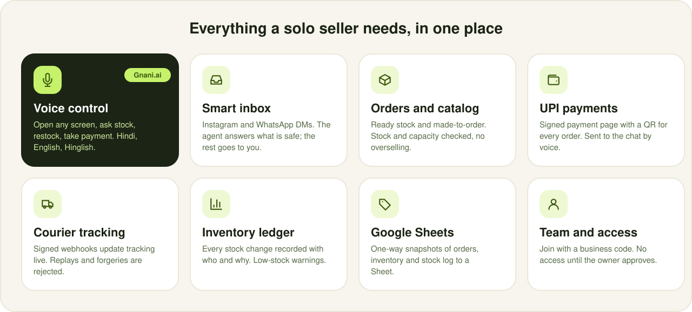
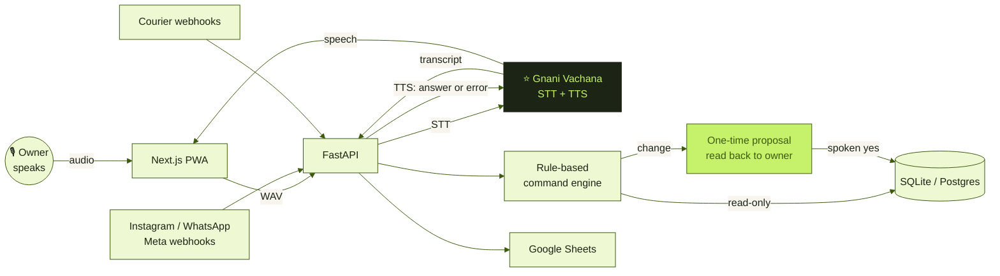

<p align="center">
  
</p>

<p align="center">
  
  
  
</p>
<p align="center">
  
  
  
  
  
</p>

<p align="center">
  <a href="#-the-problem">Problem</a> ·
  <a href="#-gnani-ai-voice-the-heart-of-factor">Gnani voice</a> ·
  <a href="#-everything-else-in-factor">Features</a> ·
  <a href="#-architecture">Architecture</a> ·
  <a href="#-run-it">Run it</a> ·
  <a href="#-demo-without-meta-or-a-courier-account">Demo</a> ·
  <a href="#-honest-limits">Limits</a>
</p>

<p align="center"></p>

## 🧡 The problem

Millions of Indian small businesses sell through **Instagram and WhatsApp DMs**. One person answers every message, writes orders in a notebook, chases payments, packs parcels, and replies to *"where is my order?"* all day. Usually with one hand free, and often in **Hindi or Hinglish**.

Existing tools are built for typing, in English, at a desk. The seller is standing at a packing table.

> **Factor turns DMs into orders, and lets the owner run everything with their voice.**
> Tap the mic. Speak. Factor does it, reads it back, and waits for a spoken **yes**.

<p align="center"></p>

<p align="center"></p>

## 🎙️ Gnani.ai voice: the heart of Factor

Voice is not a feature added on top. It is the main way to use the app, built on **Gnani.ai's Vachana APIs**.

<p align="center"></p>

| Gnani capability | How Factor uses it |
|---|---|
| 🎧 **Speech-to-text** · Vachana STT v3 (`prisma-v3.0`) | The seller speaks in Hindi, English or Hinglish. Audio goes from the browser to our API, which calls Gnani and returns the transcript. |
| 🔤 **Output formats** · `transliterate`, `codemix` | By default, English words came back in Devanagari ("हाउ मेनी रोजेस आर लेफ्ट") and commands failed. Asking Gnani for transliterated output returns clean Latin text the command engine can read. Set with `GNANI_STT_FORMAT`. |
| 🌐 **Indic auto language detection** | No language picker. The seller can switch between Hindi and English mid-sentence. |
| 🔊 **Text-to-speech** · Timbre v2.5 | Answers, read-backs, confirmations and **every error message** are spoken aloud. |

### What you can say

| 🗣️ Say this | ✅ What happens |
|---|---|
| "Open orders" · "go to inventory" · "take me to the inbox" · "kholo settings" | Navigates there. Works for every main screen, plus "open order ORD-1001" and "open chat 3". |
| "Give me a summary" | Spoken briefing: today's orders and revenue, new orders to confirm, chats waiting, low stock. |
| "How many roses are left?" · "roses kitne bache hain" | Spoken stock count, with a warning when it is low. |
| "Read low stock" · "read today's messages" · "show recent orders" | Reads the list aloud and shows it on screen. |
| "Restock 4 to roses" · "count 12 for roses" | Reads the change back, waits for **yes**, then updates stock and the ledger. |
| "Rahul ordered 2 roses" | Proposes a new order with prices taken from the catalog. |
| "Confirm order ORD-1001" · "mark ORD-1001 shipped" | Proposes the status change. Cancelling needs the extra words "yes cancel". |
| "Take payment from Riya" · "Riya se payment lo" | Finds Riya's unpaid order and sends the UPI payment QR. |
| "Reply to chat 3 saying thank you" | Reads the reply back, saves it to the chat after **yes**. |
| "What can I say?" | Lists the commands. |

### Built for how people really speak

- 🇮🇳 **Hindi script, Hinglish and English** all work. Devanagari transcripts are transliterated to Latin before parsing.
- 🔢 **Number words** become digits: "four", "char", "twenty five", "bees".
- 🔍 **Fuzzy item matching** tolerates plurals and spelling slips: "rose" finds *Roses*, "रोजेस" finds *Roses*.
- 🛟 **Tolerant of recognition mistakes**, like "saying" heard as "Singh" in a reply command.
- 🔁 **Hands-free loop**: tap once and keep talking. The mic reopens after each answer and closes when you go quiet.
- 🚨 **Errors are spoken everywhere**, even on the login screen. If Gnani speech is unavailable, the browser's own voice takes over.

### 🛡️ Voice safety

<p align="center"></p>

1. Gnani transcribes the audio.
2. A **rule-based parser** (not a language model) maps it to a known action.
3. Factor reads the change back: *"Add 4 to Roses, current stock 15."*
4. Nothing is saved until the owner says **yes** or **haan**. **No** drops it.
5. Proposals are single-use, expire in 2 minutes, and are tied to the signed-in user *and* their exact login session.

Only the server holds the Gnani API key. The browser never sees it.

<p align="center"></p>

## 🧰 Everything else in Factor

<p align="center"></p>

<details>
<summary><b>📥 Inbox that works for you</b></summary>

- Instagram and WhatsApp messages arrive through **Meta webhooks**, with signature verification.
- A **rule-based agent** answers standard questions (price, availability, tracking) from exact catalog data, and **hands over** complaints, bargaining, custom requests and payment claims to the owner.
- Two lists, **Handled by agent** and **Needs you**, refresh live every few seconds.
- The agent never invents a price or a stock number. Code decides those, always.
</details>

<details>
<summary><b>📦 Orders, catalog and inventory</b></summary>

- Ready-stock items with live quantity, and made-to-order items with capacity.
- Orders move through a checked pipeline (new, confirmed, packed, shipped, delivered) with an evidence timeline.
- Stock and capacity are checked at order time, so you cannot oversell.
- Every stock change (order, restock, count) is written to a ledger with who did it and why. Low-stock warnings show on the dashboard and by voice.
</details>

<details>
<summary><b>💸 UPI payments</b></summary>

- Each order gets a signed payment page with a **UPI QR code**.
- Say "take payment from Riya" and the QR goes to her chat.
- Delivery over Instagram or WhatsApp works once Meta sending is connected. Until then the payment link is placed in the customer's chat, ready to send.
</details>

<details>
<summary><b>🚚 Courier tracking</b></summary>

- Attach a tracking number, update status by hand, or connect a courier.
- **Signed courier webhooks** update tracking live. Events are HMAC-signed with a 5-minute window, and replays are ignored.
</details>

<details>
<summary><b>📊 Google Sheets sync</b></summary>

One-way snapshots of Orders, Inventory and Stock log to a Google Sheet, for owners who live in spreadsheets.
</details>

<details>
<summary><b>👥 Team, access and more</b></summary>

- One owner by default. Teammates join with a **business code** and get no access until the owner approves them.
- Per-person permissions, enforced on the server. Email sign-up and **Google sign-in**.
- Live overview dashboard, customer list with order history, and an activity log that includes every voice action.
- Installable as a phone app (PWA) with the Factor icon.
</details>

<p align="center"></p>

## 🏗️ Architecture



**Stack:** FastAPI · SQLAlchemy 2 · Pydantic v2 · SQLite or Postgres · Next.js 14 · Tailwind CSS · installable PWA · Gnani Vachana STT and TTS · 130+ automated tests.

> **Design principle: the AI listens, code decides.** Speech recognition turns audio into text. Prices, stock, availability and every state change are decided by deterministic code that can be tested, and the owner approves every change.

<p align="center"></p>

## 🚀 Run it

**Backend** (Windows PowerShell shown; on Mac or Linux use `source .venv/bin/activate`):

```powershell
cd apps\api
python -m venv .venv
.\.venv\Scripts\activate
pip install -r requirements.txt
copy .env.example .env      # then fill in your keys, see below
python -m pytest -q
uvicorn app.main:app --reload
```

**Frontend:**

```powershell
cd apps\web
npm install
npm run dev
```

Open <http://localhost:3000>. API docs are at <http://localhost:8000/docs>.

<details>
<summary><b>🔐 Environment variables (<code>apps/api/.env</code>)</b></summary>

| Variable | Purpose |
|---|---|
| `GNANI_API_KEY` | Your Gnani Vachana key. **Server only.** Never commit it or put it in the web app. |
| `GNANI_STT_FORMAT` | `transliterate` (default) or `codemix`. |
| `JWT_SECRET` | Long random string for sign-in tokens. |
| `GOOGLE_CLIENT_ID` | Turns on Google sign-in. |
| `COURIER_ENCRYPTION_KEY` | A Fernet key: `python -c "from cryptography.fernet import Fernet; print(Fernet.generate_key().decode())"` |
| `META_APP_SECRET` | Verifies Instagram and WhatsApp webhook signatures. |
| `GOOGLE_SERVICE_ACCOUNT_JSON` | Optional. For Google Sheets sync. |
| `DATABASE_URL` | Optional. Defaults to local SQLite. Use Postgres when deployed. |

</details>

> 🎤 Voice recording needs `localhost` or HTTPS, and microphone permission in the browser.

### ⚡ Try voice in 60 seconds

1. Sign up, create a business, add an item called **Roses** with quantity 15.
2. Tap **Voice** in the corner and say **"How many roses are left?"**
3. Say **"Restock four to roses."** Factor reads it back. Say **"yes"**.
4. Say **"Open orders."** The app navigates. Then say **"Give me a summary."**

<p align="center"></p>

## 🎬 Demo without Meta or a courier account

Two scripts play the outside world against your running app, using each service's real message formats:

```powershell
python demo_meta.py     --email you@example.com --password yourpass   # Instagram + WhatsApp DMs, handshake, forged-signature rejection
python demo_webhooks.py --email you@example.com --password yourpass   # signed courier events: picked up, in transit, out for delivery, delivered
```

Open the Inbox and an order page beside the terminal and watch them update live. Add `--api https://your-api-url` to run them against a deployed app.

## 🔒 Security

- The Gnani key, JWT secret and courier encryption key live only in the server's environment.
- Voice actions are proposals: single-use, 2-minute expiry, bound to the user and login session, and logged.
- Order cancellation by voice needs a deliberate extra word.
- Meta webhooks are signature-checked. Courier webhooks use timestamped HMAC signatures and reject replays.
- Courier credentials are encrypted at rest. Every query is scoped to the signed-in business.

## 🤝 Honest limits

We would rather you hear these from us:

- **Replies are saved in the app but not yet delivered back through Instagram or WhatsApp.** That needs Meta app review and a public HTTPS address. Incoming messages and webhooks are fully built, and the demo scripts show them working.
- Real carrier tracking APIs need each seller's own credentials. Manual and signed-webhook tracking work today.
- The voice grammar covers orders, stock, payments, navigation and replies. It does not yet cover team permissions, creating catalog items, or voice login.
- Voice understanding is rule-based by design, for safety. Unusual phrasings get a short spoken hint, never a guess.

## 🗺️ Roadmap

Send replies and payment QRs through Meta once approved · one-click "Connect Google Sheets" · voice for catalog and team management · more Indian languages in the command grammar · spoken replies in the seller's own language · a weekly business summary read aloud.

<p align="center"></p>

<p align="center">
  <b>factor.</b> Because the person running the business should not have to stop creating to type.<br>
  Built for the Great Indian AI Internship Challenge using GNANI AI (STT+TTS) by <b>Aaliya Khan</b> (SGSITS Indore) and Devansh Paliwal (SGSITS, Indore).
</p>
